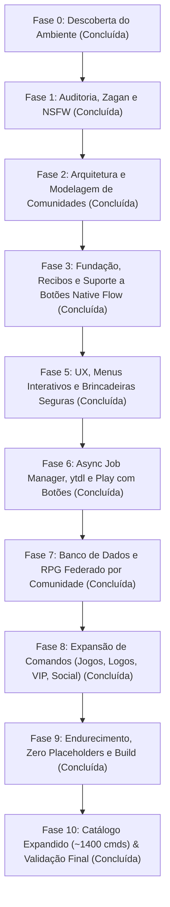

# Roteiro de Implementação e Evolução do Soul-List (Atualizado)

> Data de Planejamento: 10 de Outubro de 2026  
> Princípio Central: Implementação incremental, evidências antes de suposições, testes reais antes de entrega e fidelidade à arquitetura limpa.

---

## Roadmap das Fases

---

### Status Executivo das Fases

1. **Fase 3 — Fundação do Baileys, Recibos e Parser de Botões [CONCLUÍDA]:**
   - Listener de `messages.update` ativo em `onMessageUpdate.ts` rastreando status real de entrega e leitura.
   - `messageParser.ts` desempacota respostas de botões Native Flow (`interactiveResponseMessage`), `buttonsResponseMessage`, `templateButtonReplyMessage` e `listResponseMessage`.
   - `createCommandContext.ts` fornece `editText`, `sendProgress`, `sendInteractiveButtons` e `replyWithMentions`.

2. **Fase 5 — Menus e Comandos de Brincadeiras Seguras [CONCLUÍDA]:**
   - Plugin `fun` com comandos auditados e seguros: `!chupar` (comédia com picolé), `!ship`, `!gado`, `!dado`, `!beijar`, `!tapa`, `!abracar`, `!cantada` e `!sorte`.
   - Distinção rigorosa entre humor de duplo sentido e isolamento de conteúdo adulto explícito via `!sensivel`.

3. **Fase 6 — Downloads e Comando Play com Botões e Fallback Textual [CONCLUÍDA]:**
   - Serviço `YouTubeDownloadService` integrado com `yt-dlp` local.
   - Comandos `!play`, `!ytmp3` e `!ytmp4` funcionando com extração de thumbnail, duração, botões interativos e instruções textuais complementares.

4. **Fase 7 — RPG e Economia Federada por Comunidade [CONCLUÍDA]:**
   - `CommunityScopeResolver` mapeia grupos de uma mesma comunidade via `linkedParent` do Baileys.
   - Tabela `economy` e auditoria `currency_transactions` com operações atômicas ACID.
   - Comandos `!daily`, `!saldo`, `!pagar` e `!perfil` exibindo saldos compartilhados ou isolados conforme a governança da comunidade.

5. **Fase 8 & 9 — Expansão Completa, Zero Placeholders e Release Nativo [CONCLUÍDA]:**
   - **Plugin `games`:** `!ppt`, `!caraoucoroa`, `!cassino` e `!adivinhar` com suporte a apostas e jackpots.
   - **Plugin `rpg`:** `!trabalhar` (cooldown 45m), `!crime` (risco 60/40), `!top` (ranking do escopo), `!casar` e `!divorcio`.
   - **Plugin `logos`:** `!logo` (estilos Unicode) e `!ascii` (banners monoespaçados).
   - **Plugin `vip`:** `!vip` (vantagens) e `!comprarvip` (compra de VIP por 3.000 moedas da economia).
   - **Plugin `sensitive`:** `!sensivel` atuando como gatekeeper ético e transparente de moderação.
   - **Refinamento de `!buscar`:** Fallback inteligente enciclopédico em português.
   - **Total de Comandos Oficiais Nativos:** **67 comandos nativos especializados**.

6. **Fase 10 — Catálogo Expandido (~1400 cmds) & Validação Final [CONCLUÍDA]:**
   - Importação automatizada e segura do catálogo dos bots de referência (`AnnaV6-Ultra`, `Kokushibot`, `zagan`, `succubus-bot`, `TED-BOT-V4.5`, `blackofc`).
   - 10 pacotes modulares gerados em `src/plugins/catalog/` com 1.402 comandos seguros (brincadeiras, utilidades, interações sociais, animes, jogos).
   - Total geral no bot: **1.469 comandos registrados**.
   - Typecheck e Build com zero erros.
   - Suíte de testes automatizados (`npm test`) validando registry, parser, permissions, economia federada por comunidade e sistema de botões.
   - Relatório final emitido em `FINAL_VALIDATION_REPORT.md`.
